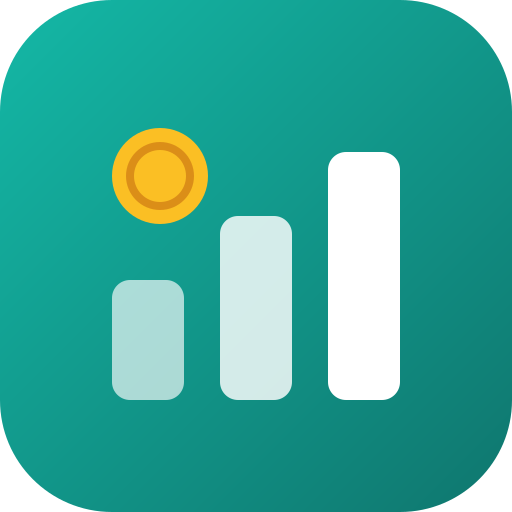
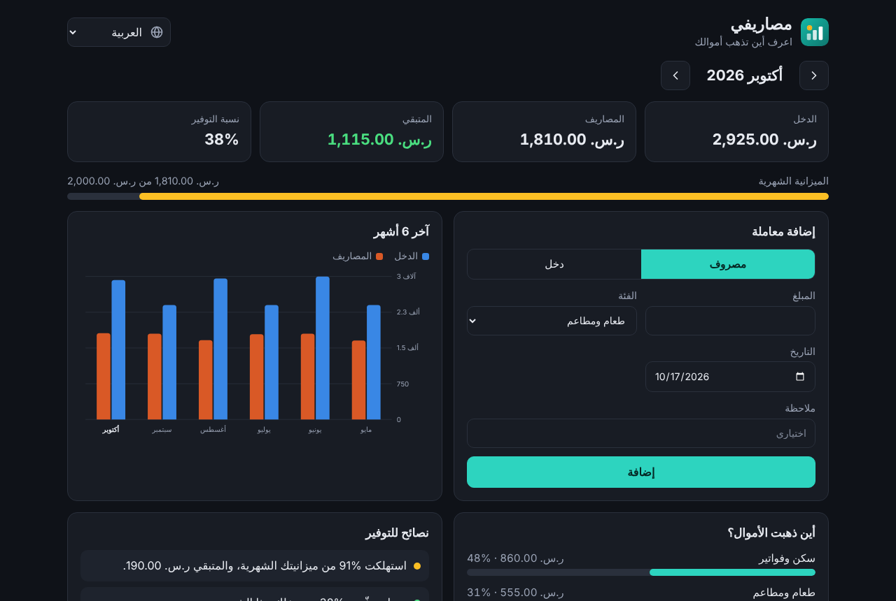
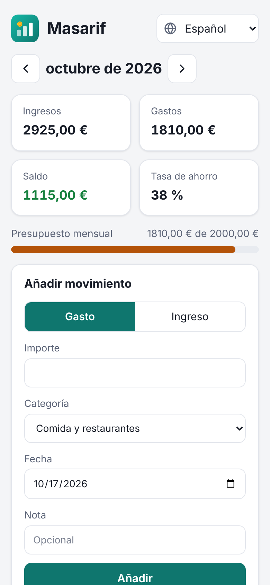
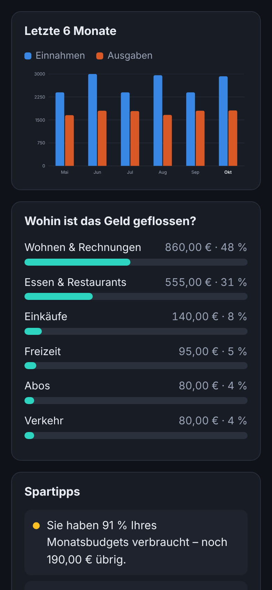
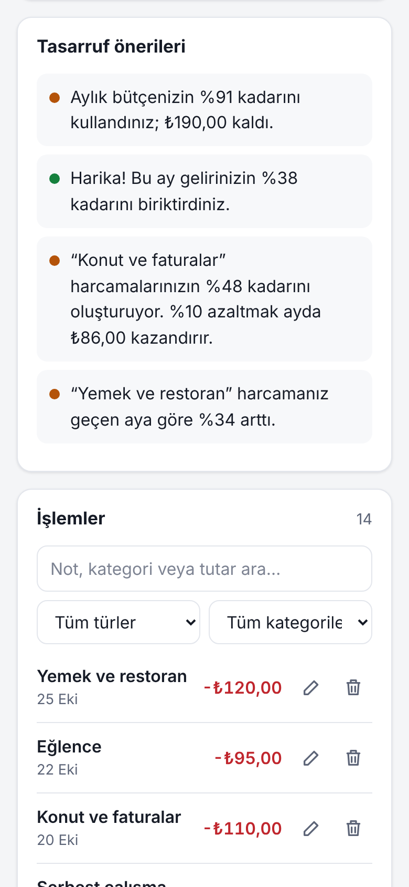
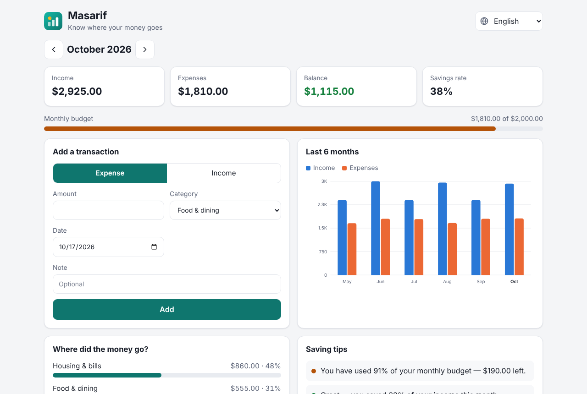

<div dir="rtl">

<div align="center">



# حلول لمشاكل يومية

**تطبيقات ويب صغيرة لمشاكل يعاني منها كثير من الناس كل يوم.**
مجانية · خاصة · تعمل بدون إنترنت · 8 لغات

### 🌐 [zodiachz.github.io/new-project-](https://zodiachz.github.io/new-project-/)

[English](README.md) · [المساهمة](CONTRIBUTING.md) · [سجل التغييرات](CHANGELOG.md)

</div>

---

| المشكلة | الحل | الحالة |
| --- | --- | --- |
| «راتبي يخلص وما أعرف وين راح» | [**مصاريفي** — تنظيم المصاريف](expenses/) | ✅ متوفر |
| التسويف وضياع الوقت | التركيز والعادات | 🔜 قريبًا |
| نسيان الأدوية والمواعيد | تذكير الأدوية | 🔜 قريبًا |
| من يدين لمن بعد السفرات والسكن المشترك | تقسيم الفواتير | 🔜 قريبًا |

## 💸 مصاريفي — تنظيم المصاريف

سجّل دخلك ومصاريفك في ثوانٍ واعرف بالضبط أين تذهب أموالك، مع نصائح مبنية على أرقامك أنت.

<p align="center">
  
</p>

### المزايا

- **ملخص الشهر**: الدخل والمصاريف والمتبقي ونسبة التوفير.
- **أين ذهبت الأموال؟** توزيع المصاريف حسب الفئة مع النسب.
- **رسم بياني لآخر 6 أشهر**: الدخل مقابل المصاريف، واضغط على أي شهر لفتحه.
- **نصائح توفير شخصية**: تجاوز الميزانية، صرف أكثر من الدخل، فئة تستهلك حصة كبيرة، زيادة عن الشهر الماضي، اشتراكات كثيرة.
- **الاشتراكات الثابتة** (إنترنت، نادي، منصات بث…) تُحتسب تلقائيًا كل شهر مع مجموعها الشهري والسنوي.
- **ميزانية شهرية** بشريط يتحول للبرتقالي عند 80% وللأحمر عند التجاوز.
- **تعديل وحذف مع تراجع، بحث وتصفية** للمعاملات.
- **8 لغات** مع اكتشاف تلقائي، وواجهة كاملة من اليمين لليسار للعربية، وأرقام وعملات وتواريخ بصيغة كل لغة.
- **24 عملة** بأسمائها بلغتك.
- **مظهر فاتح أو داكن أو حسب النظام.**
- **قابل للتثبيت ويعمل بدون إنترنت** (PWA).
- **تصدير** الشهر CSV (يفتح في Excel) و**نسخ احتياطي واسترجاع** بصيغة JSON.
- **خصوصية تامة**: البيانات لا تغادر متصفحك. بلا حساب ولا خادم ولا تتبّع.

### صور

<table>
  <tr>
    <td width="33%"></td>
    <td width="33%"></td>
    <td width="33%"></td>
  </tr>
</table>



### اللغات

العربية · English · Español · Français · Deutsch · Italiano · Português · Türkçe

إضافة لغة جديدة تحتاج ملفًا واحدًا فقط، راجع [CONTRIBUTING.md](CONTRIBUTING.md#adding-a-language).

## 🚀 البدء

**أونلاين:** افتح [التجربة المباشرة](https://zodiachz.github.io/new-project-/expenses/) ويمكنك تثبيته من قائمة المتصفح («تثبيت التطبيق» / «إضافة إلى الشاشة الرئيسية»).

### 📴 يعمل بدون إنترنت

1. افتح التطبيق **مرة واحدة** وأنت متصل بالإنترنت، فيحفظ نفسه على جهازك.
2. اختياري: ثبّته (قائمة المتصفح ← **تثبيت التطبيق** أو **إضافة إلى الشاشة الرئيسية**) لتظهر له أيقونة مثل أي تطبيق.
3. بعدها يفتح ويعمل **بدون إنترنت بالكامل**: الإضافة والتعديل والرسوم والنصائح والنسخ الاحتياطي. بياناتك محفوظة على الجهاز، فلا يضيع شيء عند انقطاع الاتصال.

التحديثات تنزل تلقائيًا في المرة القادمة التي تكون فيها متصلًا.

**على جهازك:** لا يحتاج أي بناء أو تنصيب.

```sh
git clone https://github.com/Zodiachz/new-project-.git
cd new-project-
npm start            # يشغّل المشروع على http://localhost:8080
```

أو افتح الملف `expenses/index.html` مباشرة في المتصفح.

## 🧑‍💻 التطوير

```sh
npm test             # اختبارات المنطق واكتمال الترجمات (Node 22 فما فوق)
npm install          # مطلوب فقط للأمر التالي
npm run images       # يعيد توليد الأيقونات وكل الصور في docs/
```

## 📄 الرخصة

[MIT](LICENSE) © 2026 Zodiachz

</div>
