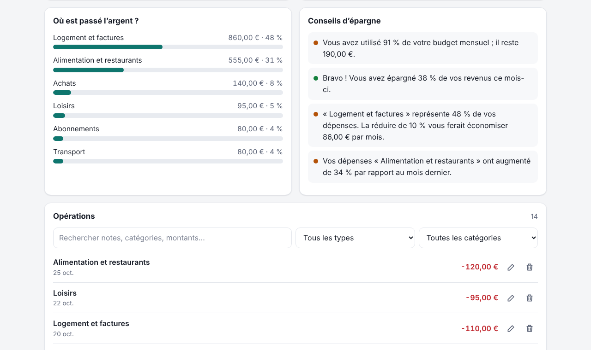

<div align="center">


# Everyday Solutions

**Small web apps for problems many people face every day.**
Free · private · offline · 8 languages

[](https://github.com/Zodiachz/new-project-/actions/workflows/ci.yml)
[](LICENSE)


[**Live demo**](https://zodiachz.github.io/new-project-/) · [العربية](README.ar.md) · [Contributing](CONTRIBUTING.md) · [Changelog](CHANGELOG.md)

</div>

---

| Problem | Solution | Status |
| --- | --- | --- |
| “My salary runs out and I don’t know where it went.” | [**Masarif** — expense tracker](expenses/) | ✅ Available |
| Procrastination and lost days | Focus & habits | 🔜 Planned |
| Forgetting medication and appointments | Medication reminders | 🔜 Planned |
| Who owes whom after trips and shared rent | Bill splitting | 🔜 Planned |

## 💸 Masarif — expense tracker

Record your income and expenses in seconds and see exactly where your money goes, with advice based on your own numbers.

<p align="center">
  
</p>

### Features

- **Monthly overview** — income, expenses, balance and savings rate at a glance.
- **Where did the money go?** — spending by category with shares.
- **Six-month trend** — income vs. expenses per month; click a month to open it.
- **Personal saving tips** — over budget, spending more than you earn, one category eating your budget, categories rising vs. last month, too many subscriptions.
- **Subscriptions** — internet, gym, streaming… counted automatically every month, with monthly and yearly totals.
- **Monthly budget** with a progress bar that turns amber at 80% and red when exceeded.
- **Edit, delete with undo, search and filter** your transactions.
- **8 languages** with automatic detection, full right-to-left layout for Arabic, and localized numbers, currencies, dates and CSV headers.
- **24 currencies**, with names shown in your language.
- **Light, dark or system theme.**
- **Installable and offline** (PWA).
- **Export** the month to CSV (opens in Excel / Google Sheets) and **back up / restore** everything as JSON.
- **Private** — data never leaves your browser. No account, no server, no tracking.

### Screenshots

<table>
  <tr>
    <td width="50%"></td>
    <td width="50%"></td>
  </tr>
  <tr>
    <td align="center"><sub>Arabic · dark · right-to-left</sub></td>
    <td align="center"><sub>French · insights and transactions</sub></td>
  </tr>
</table>

<table>
  <tr>
    <td width="33%"></td>
    <td width="33%"></td>
    <td width="33%"></td>
  </tr>
  <tr>
    <td align="center"><sub>Spanish · phone</sub></td>
    <td align="center"><sub>German · phone · dark</sub></td>
    <td align="center"><sub>Turkish · saving tips</sub></td>
  </tr>
</table>

### Languages

| | Language | | Language |
| --- | --- | --- | --- |
| 🇬🇧 | English | 🇩🇪 | Deutsch |
| 🇸🇦 | العربية (RTL) | 🇮🇹 | Italiano |
| 🇪🇸 | Español | 🇵🇹 | Português |
| 🇫🇷 | Français | 🇹🇷 | Türkçe |

Missing yours? Adding a language is a single file — see [CONTRIBUTING.md](CONTRIBUTING.md#adding-a-language).

## 🚀 Getting started

**Use it online:** open the [live demo](https://zodiachz.github.io/new-project-/expenses/) and, if you like, install it from the browser menu (“Install app” / “Add to Home screen”).

**Run it locally:** there is nothing to build or install.

```sh
git clone https://github.com/Zodiachz/new-project-.git
cd new-project-
npm start            # serves the folder on http://localhost:8080
```

You can also just open `expenses/index.html` in a browser (offline install needs `http://`).

## 🧑‍💻 Development

```sh
npm test             # unit tests + translation completeness checks (Node 22+)
npm install          # only needed for the next command (installs Playwright)
npm run images       # re-renders the app icons and every screenshot in docs/
```

```
├── index.html               Landing page listing all solutions
├── expenses/                Masarif — expense tracker
│   ├── index.html
│   ├── css/styles.css       Design tokens, light/dark, RTL-aware layout
│   ├── js/logic.js          Pure logic: totals, tips, CSV, import validation
│   ├── js/i18n.js           Language detection, translation, RTL switching
│   ├── js/chart.js          Accessible SVG trend chart
│   ├── js/app.js            UI and storage
│   ├── locales/*.js         One file per language
│   ├── sw.js                Offline cache
│   └── tests/               node:test suites
├── docs/screenshots/        README images (generated)
├── scripts/                 Local server and image generator
└── .github/                 CI, GitHub Pages deploy, issue templates
```

Design principles: no runtime dependencies or build step, every amount and date formatted through `Intl`, all user text translated, keyboard and screen-reader friendly, works from 320 px wide.

### Deploying

Pushing to `main` deploys the landing page and apps to GitHub Pages through [`.github/workflows/pages.yml`](.github/workflows/pages.yml). Enable it once under **Settings → Pages → Source: GitHub Actions**.

## 🗺️ Roadmap

- [x] Expense tracker
- [ ] Focus & habits (to-do list, Pomodoro timer, habit streaks)
- [ ] Medication reminders (doses, appointments, history)
- [ ] Bill splitting (groups, shared expenses, settle up)
- [ ] More languages

## 🤝 Contributing

Bug reports, ideas and translations are very welcome. Read [CONTRIBUTING.md](CONTRIBUTING.md) to get started.

## 📄 License

[MIT](LICENSE) © 2026 Zodiachz
